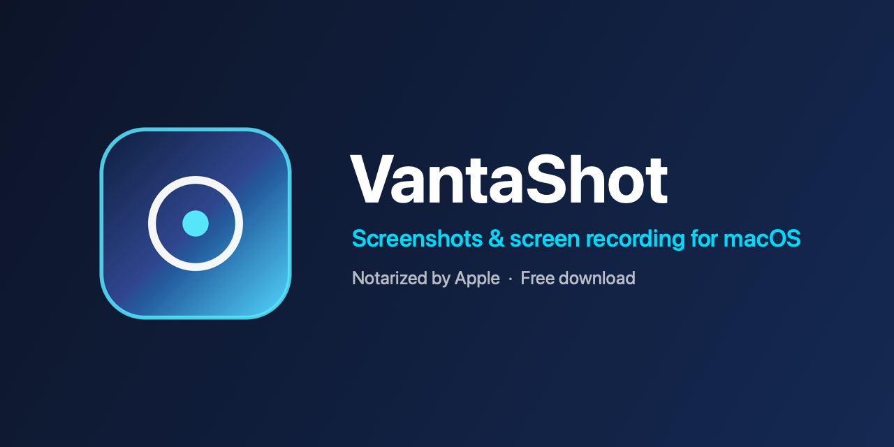
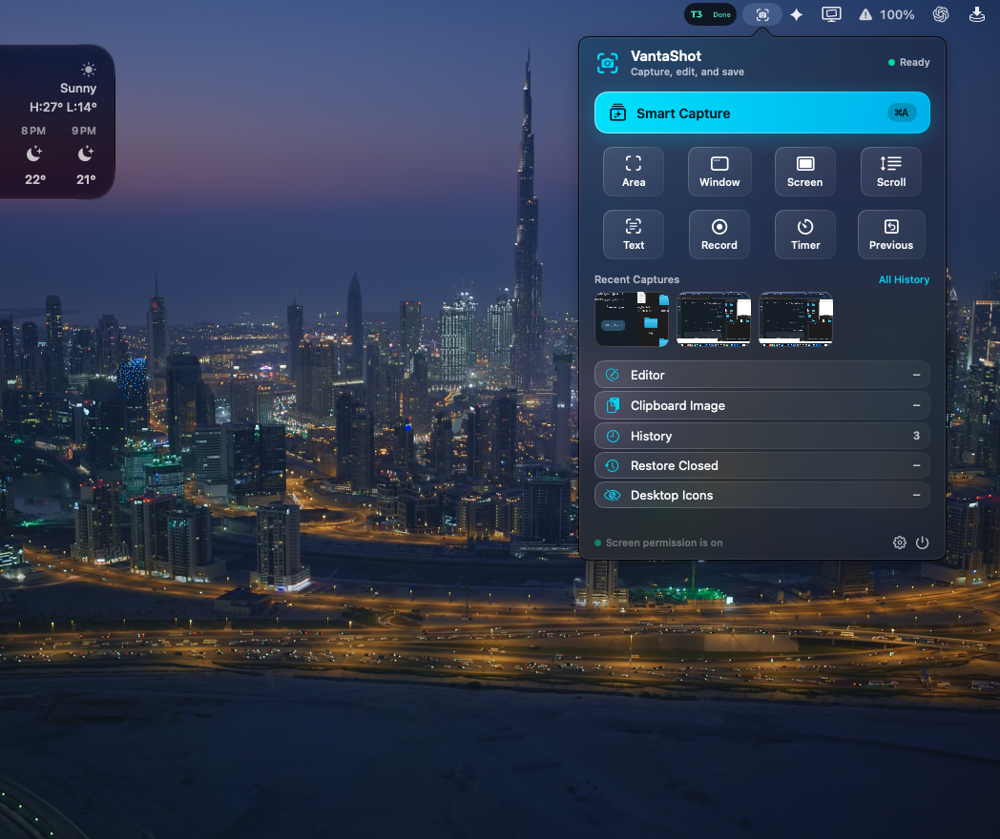
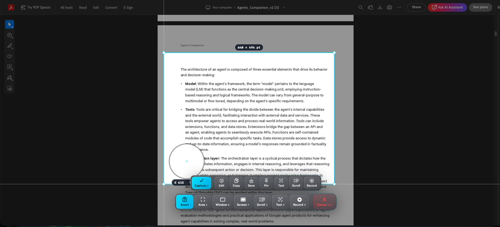
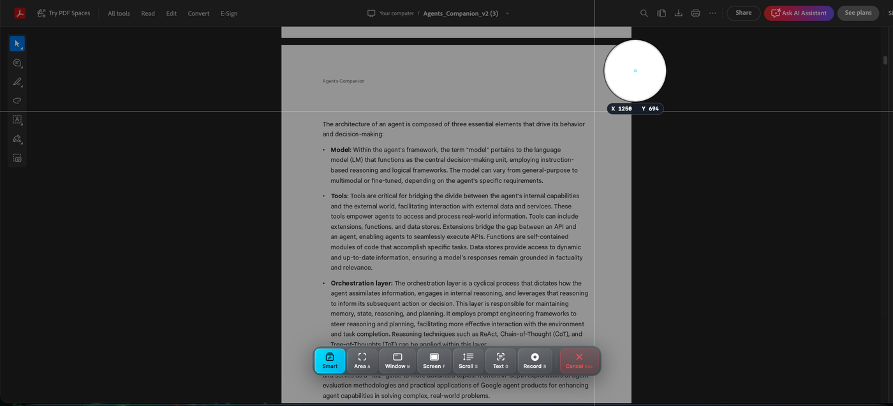
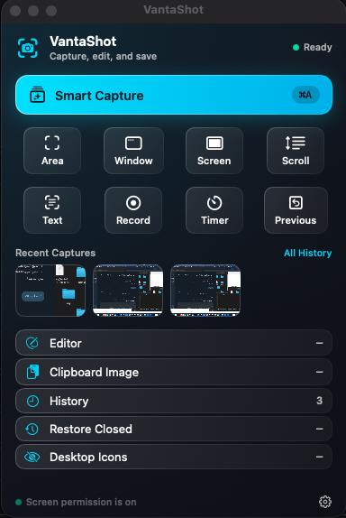

<div align="center">



One bar for area, window, full screen, scrolling pages, text (OCR), video and GIF.
Annotate, pin, or copy without leaving the capture. Nothing leaves your Mac.

**[Download for macOS](https://github.com/khaled1174/VantaShot/releases/latest)**
&nbsp;·&nbsp;
[What's new](CHANGELOG.md)

</div>



## Download

**[Download the latest version](https://github.com/khaled1174/VantaShot/releases/latest)**,
then pick the `VantaShot-<version>-arm64.dmg` file under **Assets**.

The app is signed with Developer ID and notarized by Apple, so macOS opens it
without a security warning.

**Requirements:** macOS 13 Ventura or newer, on a Mac with Apple silicon (M1 or later).
Intel Macs are not supported yet.

## Install

1. Open the downloaded `.dmg` file.
2. Drag **VantaShot** into the **Applications** folder.
3. Open VantaShot from Applications.

### Permissions

macOS asks for these the first time you use each feature. You can also turn them
on from VantaShot **Settings → Permissions and About**.

| Permission | Needed for |
| --- | --- |
| Screen Recording | All screenshots and screen recordings |
| Microphone | Voiceover in video recordings (optional) |
| Accessibility | Scrolling capture |
| Input Monitoring | Showing keystrokes in recordings (optional) |

After you turn on Screen Recording, macOS may ask you to quit and reopen VantaShot.

## Features

- **Smart Capture:** select an area, then choose area, window, full screen, scrolling,
  text, or recording from one bar.
- **Area, Window, and Full Screen** capture, plus a self-timer and "capture the
  previous area again".
- **Scrolling capture** for long pages.
- **Copy text (OCR)** from anything on screen.
- **Video and GIF recording** with optional microphone, system audio, cursor, and keystrokes.
- **Editor** with arrows, shapes, text, highlighter, numbered steps, pixelate,
  redact, spotlight, and crop.
- **Capture cards:** every capture stays on screen until you close it, so you can
  take several and use each one where you need it.
- **History** of recent captures with search, filters, Select All, bulk delete, and Empty Trash.
- **Pins:** keep a screenshot floating above other windows.

## How it looks

Pick the capture mode from one bar — no need to remember a shortcut first.



A magnifier and a live `W × H` readout, so the crop is exactly the crop you meant.



Recent captures, history, editor, and a desktop-icon toggle, one click from the menu bar.



## Updates

See [CHANGELOG.md](CHANGELOG.md) for what changed in each version. New versions are
published on the [Releases page](https://github.com/khaled1174/VantaShot/releases).

## License

VantaShot is free to download and use, with no account and no subscription.

Copyright © 2026 Khaled Almkhlfi. All rights reserved.

You may download and use the official VantaShot releases. The source code is
published for reference only. You may not copy, modify, or redistribute it without
written permission. See [LICENSE](LICENSE).

---

## For developers: build from source

Building from source needs Xcode with Swift 5.9 or newer and the command line tools.

```bash
git clone https://github.com/khaled1174/VantaShot.git
cd VantaShot
swift build
swift test
bash bundle-app.sh   # writes dist/VantaShot.app
```

`bundle-app.sh` signs with a Developer ID or Apple Development identity if one is in
your Keychain, otherwise with an ad-hoc signature. Notarized releases are made with
`script/notarize_release.sh`. See [NOTARIZATION.md](NOTARIZATION.md).

Manual checks are in [Tests/ManualAcceptance.md](Tests/ManualAcceptance.md) and
[Tests/ManualShortcutsAcceptance.md](Tests/ManualShortcutsAcceptance.md).
